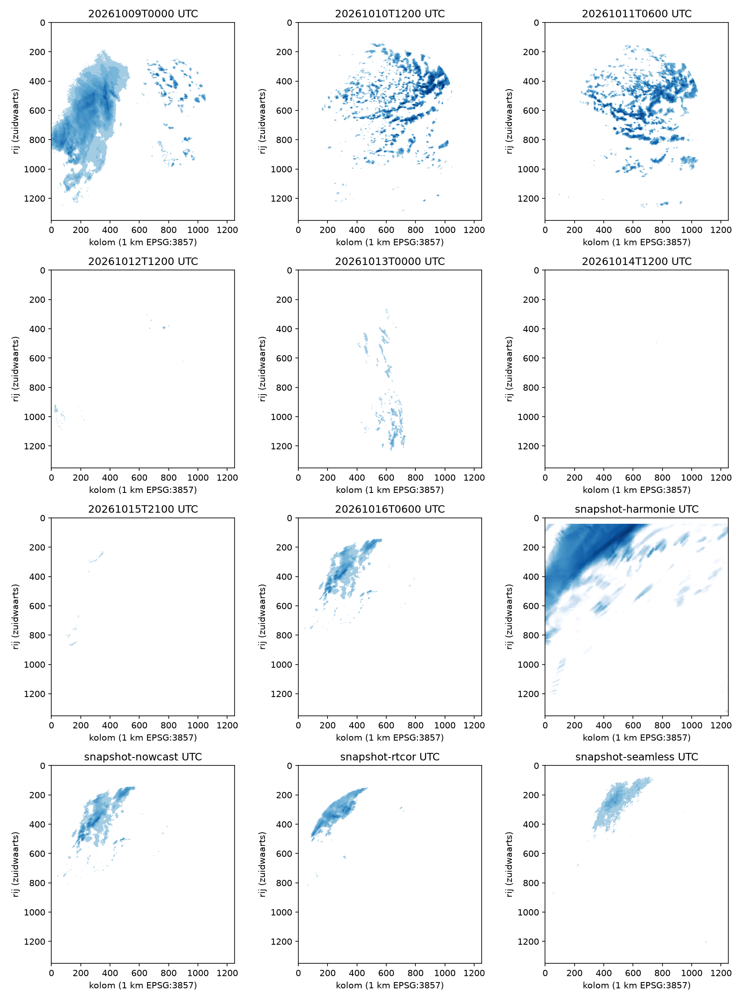

# Windkalibratie van regenbeweging — U84

Onderzoek van 16 oktober 2026; geen productiecode of VM-gegevens gewijzigd.

De 300 meterwind is soms nuttig in regenblokken zonder correlatie, maar één
schaal en rotatie voor het hele neerslagveld verplaatst lokaal goede wind ook
verkeerd. Op de probleemsnapshot is de mediane fout van de opgeslagen nowcast
1,80 cellen/5 min, tegenover 0,71 zonder wind, op dezelfde 1.234 meetblokken.
Huber, een mediaanfit, een ruimere rotatieklem en regionale/tijdelijke fits
lossen dit niet algemeen op. Bij vrijwel afwezige regen kan wind juist extra
dekking geven. Voor HARMONIE-uurframes is deze meting niet beslissend.

Dit rapport bevat metingen; het beleidsvoorstel staat uitsluitend in
[MIP-33](../.dev/proposals/0033-windprior-na-validatie.md), met status draft.

## Corpus en meetmethode

Acht uurvensters van 9–16 oktober, telkens dertien RTCOR-frames met vijf minuten
tussenruimte. Wind komt uit de p1-run van drie uur eerder, met de twee
modeluren die het hele venster insluiten. Daarnaast de bevroren snapshot
`2026-10-16-0810`: RTCOR 03:10–06:05, nowcast 06:00–08:00, seamless
08:00–11:55 en de eerste zeven HARMONIE-frames 04:00–10:00 UTC.
Het volledige gedeelde raster telt 1.250×1.350 Mercatorcellen; één cel is
1 km **op EPSG:3857**, bij 53°N ongeveer 602 meter op de grond.

De Rust-audit gebruikt de echte brondecoders, `IndexMap`, regenkwantisatie,
`motion::correlate`, `calibrate`, `blend_with_wind` en `estimate`. De 300 meter-
en 10 meterwind doorlopen dezelfde blokmiddeling, omrekening en `WindTimeline`.
De auditkopie van de private `motion_wind_blocks` is expliciet gemarkeerd.

De onafhankelijke referentie is OpenCV `TM_CCOEFF_NORMED` op alle pixels van
32×32-blokken na `log1p`, zonder het globale startpunt of de vierpixelsteekproef
van productie. Zoekafstand ±24 cellen bij vijf minuten, ±150 bij een uur.
Een zichtbaar blok heeft minstens vier positieve regenpixels. Alleen matches
met score ≥0,7, verschil met de tweede piek ≥0,005 buiten de directe 3×3-piek,
en een heen/terugafwijking ≤2 cellen tellen mee. No-data, vlakke patronen,
zoekgrenspieken en rasterranden leveren geen referentie. Dit is gemeten
patroonverplaatsing, geen meteorologische grondwaarheid bij groei en uitdoving.

De eerste, derde enzovoort paren leveren de alternatieve windfit; de tweede,
vierde enzovoort de evaluatie. Het zijn verschillende frameparen binnen dezelfde
weergebeurtenis, geen onafhankelijke stormen. De radarvariant gebruikt de eigen
correlatie van het geëvalueerde paar, zoals de werkelijke ingest. De fout is de
Euclidische vectorafstand in **cellen per vijf minuten**, ook bij uurframes.

De tabellen met `n gemeen` vergelijken precies dezelfde blokken waar alle
kandidaten een vector hebben. Afzonderlijke dekkingscijfers tonen wat daarbuiten
gebeurt. De volledige resultaten bevatten ook gemiddelden, p90, sterke blokken,
bewegende blokken en de score≥0,85-controle.

| start UTC (1 uur) | beeld uit radar | regen op raster | p95 mm/uur | referenties evaluatie | n gemeen |
| --- | --- | --- | --- | --- | --- |
| 20261009T0000 | breed regenveld, nacht | 17.47% | 1.07 | 1321 | 1321 |
| 20261010T1200 | buiige banden, middag | 9.30% | 4.72 | 2257 | 2248 |
| 20261011T0600 | buiige banden, ochtend | 10.66% | 3.48 | 1929 | 1919 |
| 20261012T1200 | zeer weinig regen, middag | 0.11% | 0.24 | 34 | 22 |
| 20261013T0000 | lichte regenbanden, nacht | 1.47% | 0.36 | 477 | 473 |
| 20261014T1200 | vrijwel droog, middag | 0.00% | 0.24 | 0 | 0 |
| 20261015T2100 | zeer weinig lichte regen, nacht | 0.09% | 0.12 | 15 | 8 |
| 20261016T0600 | regenband, ochtend | 4.17% | 0.85 | 382 | 365 |

De beelden beschrijven de vorm van het regenveld; een meteorologische
frontclassificatie is niet onafhankelijk vastgesteld. Er zijn zeven meetbare
weekvensters en één droge controle. De kleine aantallen op 12 en 15 oktober
zijn aanwijzingen, geen sterke schatting van de prestatiewinst.



Rijen nemen zuidwaarts toe. Donkerder blauw is meer regen; logaritmische
kleurschaal 0,01–10 mm/uur. De vier snapshotpanelen zijn aanvullende
bronvergelijkingen, geen extra onafhankelijke weekdatasets.

## Windveld: parameters, oriëntatie, plaats en tijd

Alle geselecteerde echte berichten: editie 1, centrum KNMI, lokale tabel 253,
parameter 33/34, niveau 10 of 300 meter, instantaan (`timeRangeIndicator=0`).
De [KNMI-parametertabel](https://www.knmidata.nl/open-data/harmonie) specificeert
hiervoor niveaucode 105 en m/s. De ecCodes-selector noemt deze lokale niveaucode
`sfc`; het getal 300 bepaalt hier de hoogte, niet de gebruikelijke betekenis van
een automatisch afgeleide veldnaam. `shortName`/`units` worden niet gebruikt.

`gridType=regular_ll`, 390×390, `scanningMode=64`,
`jPointsAreConsecutive=0`, `resolutionAndComponentFlags=136`,
`uvRelativeToGrid=1`. De componenten zijn dus **gridrelatief**. Op dit
ongeroteerde lengte-/breedteraster zijn de positieve rasterassen oost/noord;
er is hier geen extra rotatie. Dit mag niet worden overgenomen voor het
**geroteerde** p3-raster. De productie-array is voor alle onderzochte 10/300
meterberichten element voor element gelijk aan ecCodes `values`: geen
transpositie of omgekeerde bronrijen gevonden.

Doelblokken lopen van noord naar zuid, in rijen van 40 blokken; de laatste rij
is gedeeltelijk. Middeling gebeurt per echt 32×32-blok, niet via proportionele
verdeling over 40×43. De lokale omzetting is `60/(1000*cos(latitude))` naar
cellen/minuut; noordelijke V krijgt een negatief rijteken. Bij 53°N is dat
ongeveer 0,0997 cel/min per m/s. Het tijdstip is het midden van ieder regenpaar.
Wind wordt lineair tussen geldige modeluren geïnterpoleerd; de modelrun is
geen geldigheidstijd. De hoofdmetingen blijven binnen de beschikbare winduren.
RTCOR-randdekking krijgt de gedocumenteerde doorgetrokken randwind.

Een directe controle bij 3,97°E, 53,06°N om 06:00 UTC geeft:

| veld | U oost (m/s) | V noord (m/s) |
|---|---:|---:|
| p1 op 10 meter, dichtstbijzijnde bronpunt | 7,018 | 4,436 |
| gepubliceerde kaartwind, 6 km raster | 6,75 | 4,50 |
| p1 op 300 meter, dichtstbijzijnde bronpunt | 11,023 | 4,705 |

De kaartwind gebruikt dus aantoonbaar de 10 meterlaag. Het kleine verschil is
verenigbaar met herprojectie, het grovere kaartrooster en kwantisatie; dit is
geen vergelijking met een gemeten windstation. De ruwe 300 meterwind voorspelt
hier ongeveer (+5,5, −2,35) cellen/5 min, dicht bij de gemeten drijver (+5, −3).
Een grote globale rotatie maakt deze lokaal bruikbare wind juist slechter.

Als sterke end-to-end-controle reproduceert de Rust-audit met de opgehaalde
winduren alle opgeslagen vectoren exact: RTCOR **60.200/60.200**,
nowcast **41.280/41.280**, seamless **80.840/80.840**. Daarmee zijn ook blokindex,
rijteken, tijdinterpolatie en schaal van de gereconstrueerde pipeline gecontroleerd.
HARMONIE wijkt hier bewust af: de nieuwe fit gebruikt zeven frames, de opgeslagen
fit 48; beide worden in de resultaten afzonderlijk gemeten.

## Waarom de fit onbruikbaar wordt

De fit telt blok×tijd-monsters. Twaalf monsters hoeven geen twaalf onafhankelijke
regengebieden te zijn. De schaal/rotatie wordt bovendien door `confidence*|wind|²`
gewogen: meer wind betekent meer invloed, ook zonder meer bruikbaar regensignaal.
De tabel toont de vrije hoek vóór de klem, naast de spreiding van individuele
correlatie/wind-hoeken. Positieve hoeken zijn in het rij-omlaagstelsel met de klok mee.

| start UTC | sterke monsters | unieke blokken | schaal | vrije hoek | hoek p10 / p50 / p90 |
| --- | --- | --- | --- | --- | --- |
| 20261009T0000 | 2968 | 564 | 0.92 | 32.77 | -10.12 / 25.24 / 73.33 |
| 20261010T1200 | 4301 | 613 | 0.95 | 2.43 | -14.16 / 1.91 / 24.70 |
| 20261011T0600 | 3759 | 509 | 0.90 | 20.51 | -2.01 / 18.19 / 45.09 |
| 20261012T1200 | 54 | 21 | 0.70 | 91.74 | 43.52 / 85.69 / 131.12 |
| 20261013T0000 | 657 | 135 | 0.63 | 70.46 | 44.87 / 70.27 / 97.15 |
| 20261014T1200 | 0 | 0 | 1.00 | — | — |
| 20261015T2100 | 15 | 10 | 1.63 | -15.13 | -33.77 / -6.76 / 16.95 |
| 20261016T0600 | 902 | 203 | 1.23 | -97.53 | -131.29 / -106.98 / -6.93 |

Op 16 oktober zijn er 902 sterke monsters op 203 verschillende blokken, zonder
nulvectoren. De vrije fit is −97,53°; de productie gebruikt −60°. Binnen dat uur
liggen de vrije fits per afzonderlijk paar tussen −112,1° en −81,7°. De tien
procent zwaarst gewogen monsters hebben 21,4% van het gewicht. Zonder de vijf
zwaarste **ruimtelijke** blokken blijft de hoek −100,53°; zonder de twee buitenste
blokrijen/-kolommen −98,38°. Een paar randblokken of stilstaande clutter verklaren
dit geval dus niet. De sterke correlatie klopt op veel onafhankelijk gemeten
blokken wel: regen beweegt oost/noord, terwijl de 300 meterwind in het noordelijke
regengebied overwegend zuidwaarts wijst. Bij de gemelde drijver is de ruwe wind
juist al bruikbaar. Eén factor voor deze gebieden past niet.

Op 15 oktober zijn er slechts vijftien sterke monsters op tien blokken. Zonder
de vijf zwaarste blokken blijven zes monsters over en valt de fit terug. Op
12 oktober zijn er 54 monsters op 21 blokken; geen afzonderlijk paar haalt de
minimumtelling. Ook dit is meetbaar een zwakke kalibratiebasis. Een minimale
telling alleen toetst geen ruimtelijke dekking of modelgeschiktheid.

De **technische oorzaak** is daarmee aangetoond: een ruimtelijk ongeschikte en
soms zeer zwak bepaalde globale fit wordt ook in lege blokken gebruikt, waarna
ongewogen smoothing die prior terugmengt in sterke correlatieblokken. Of de
onderliggende meteorologische tegenstelling vooral verticale schering, een
modelafwijking of neerslagpropagatie is, is hier niet geïsoleerd. Er is geen
parameter-, eenheden- of tekenfout aangetoond.

### Productiejournal

Bevroren venster 9 oktober 00:00 t/m 16 oktober 07:43 UTC. Dit zijn logregels,
met mogelijk herhaalde bronruns na een herstart; geen onafhankelijke gebeurtenissen.

| bron | logregels | rotatieklem | fallback | sterke monsters p10 / p50 / p90 |
| --- | --- | --- | --- | --- |
| harmonie | 61 | 0 (0.0%) | 0 | 2364 / 5206 / 9559 |
| nowcast | 2146 | 501 (23.3%) | 340 | 0 / 1506 / 9116 |
| rtcor | 2148 | 408 (19.0%) | 282 | 1 / 2100 / 12470 |
| seamless | 699 | 143 (20.5%) | 125 | 0 / 2184 / 14145 |

De claim “ruim een derde van alle runs deze week” wordt voor dit hele venster
niet bevestigd. De problemen zijn sterk per dag geclusterd: 12 oktober RTCOR
67,9% en nowcast 75,3% tegen de klem; 16 oktober tot dit meetmoment 76,3% en
91,4%. Op 10 en 11 oktober bereiken beide bronnen de klem helemaal niet.

## Alternatieven op dezelfde weekvensters

`Huidig` gebruikt de native fit op alle paren, dus inclusief de evaluatieparen,
zoals een complete productierun. Alle alternatieve windfits gebruiken uitsluitend
de trainingsparen. `LS300` is die bestaande fit met deze eerlijkere dataselectie.
`Huber` herweegt vectorresiduen met grens 0,3 cel/min; `Mediaanfit` neemt de
componentmediaan van de complexe correlatie/windverhouding. `Regio` gebruikt vier
rasterkwadranten met Huber en verwijdert nulbeweging uit de fit. `Tijd` gebruikt
alleen het voorgaande trainingspaar. Te weinig monsters betekent default (1,0),
zonder een niet-reproduceerbare vorige fit te verzinnen. De daadwerkelijke
snapshotannex blijft daarnaast apart beschikbaar.

`Geklemd optimum` corrigeert een concreet rekenkundig tekort: na het begrenzen
van de hoek moet de schaal opnieuw op die hoek geprojecteerd worden. De huidige
code klemt schaal en hoek onafhankelijk, wat geen constrained least-squaresminimum
oplevert. `Vrije hoek` laat uitsluitend de rotatieklem los; schaal blijft begrensd.
`10m-fit` wisselt alleen de stuurlaag.

`Runmediaan` gebruikt de componentmediaan van sterke correlaties van het eigen
framepaar als prior, met terugval op alle correlaties als er geen sterke zijn.
`Zonder wind` is de huidige `motion::estimate` met buurerving en smoothing, dus
geen U82-implementatie. Alle varianten behouden dezelfde menging/smoothing, behalve
de extra `median_anchor`-proef in het JSON die sterke blokken na smoothing herstelt.

Mediane fout, op gemeenschappelijke meetblokken, cellen/5 min:

| start UTC | n gemeen | Huidig | LS300 | Huber | Mediaanfit | Regio | Tijd | 10m-fit | Runmediaan | Zonder wind |
| --- | --- | --- | --- | --- | --- | --- | --- | --- | --- | --- |
| 20261009T0000 | 1321 | 2.00 | 1.80 | 1.80 | 1.80 | 1.41 | 1.80 | 2.12 | 1.50 | 1.12 |
| 20261010T1200 | 2248 | 1.00 | 1.00 | 1.00 | 1.00 | 1.00 | 1.00 | 1.12 | 1.00 | 1.00 |
| 20261011T0600 | 1919 | 1.00 | 1.00 | 1.00 | 1.00 | 0.71 | 1.00 | 1.12 | 1.00 | 0.71 |
| 20261012T1200 | 22 | 2.37 | 2.37 | 2.37 | 2.28 | 2.15 | 4.84 | 2.06 | 3.00 | 2.60 |
| 20261013T0000 | 473 | 1.12 | 1.12 | 1.12 | 1.12 | 1.12 | 1.12 | 1.80 | 1.12 | 1.00 |
| 20261014T1200 | 0 | — | — | — | — | — | — | — | — | — |
| 20261015T2100 | 8 | 7.69 | 6.93 | 6.93 | 6.93 | 6.93 | 6.93 | 9.90 | 9.90 | 11.49 |
| 20261016T0600 | 365 | 3.54 | 3.54 | 3.61 | 3.61 | 3.35 | 3.61 | 3.54 | 2.06 | 1.80 |

| start UTC | LS300 | Geklemd optimum | Vrije hoek | Gate → runmediaan |
| --- | --- | --- | --- | --- |
| 20261009T0000 | 1.80 | 1.80 | 1.80 | 1.50 |
| 20261010T1200 | 1.00 | 1.00 | 1.00 | 1.00 |
| 20261011T0600 | 1.00 | 1.00 | 1.00 | 1.00 |
| 20261012T1200 | 2.37 | 2.37 | 2.09 | 3.00 |
| 20261013T0000 | 1.12 | 1.12 | 1.12 | 1.12 |
| 20261014T1200 | — | — | — | — |
| 20261015T2100 | 6.93 | 6.93 | 6.93 | 9.90 |
| 20261016T0600 | 3.54 | 3.35 | 3.61 | 2.06 |

De geteste gate eist ≥100 sterke trainingsmonsters, een mediane fitafwijking
≤2,5 cellen/5 min en een vrije hoek binnen ±55°; anders gebruikt hij de runmediaan.
Deze arbitraire onderzoeksgrenzen verbeteren 16 oktober maar missen de mogelijke
windwinst op 12 en 15 oktober. Dit zijn dus **geen gevalideerde productiegrenzen**.
Het verwijderen van nulvectoren geeft in deze weekvensters dezelfde medianen als
LS300; de volledige cijfers staan onder `moving_ls300` in het JSON.

De juiste projectie na hoekbegrenzing verlaagt 16 oktober de mediane fout van
3,54 naar 3,35. Dat blijft ver boven 1,80 zonder wind. Alleen de klem verruimen
gaat juist naar 3,61. Op de snapshot-nowcast verlaagt dat wel de mediaan, maar
verhoogt het de p90 van circa 5,0 naar 7,43. Er is geen algemene winnaar onder
de windfits; op 9–11 oktober verschuiven de uitkomsten nauwelijks ondanks
extra modelcomplexiteit. Geen van deze goedkope fitwijzigingen redt de prior.

## Regenblokken zonder eigen correlatie: is wind daar nuttig?

Hier telt een ontbrekende correlatie als `None`, niet als een zwakke correlatie.
De telling geldt voor zichtbare **bronblokken** van de evaluatieparen. Nieuwe regen
alleen in het bestemmingsframe valt buiten deze verplaatsingsreferentie. Herhaalde
blokken over verschillende paren worden meegeteld. `n vergelijkbaar` is de
referentiesubset waar ook de radarvariant een vector heeft.

| start UTC | geen correlatie / zichtbaar | referentie zonder correlatie | n vergelijkbaar | Huidig | Runmediaan | Zonder wind | dekking zonder wind |
| --- | --- | --- | --- | --- | --- | --- | --- |
| 20261009T0000 | 461/3041 (15.2%) | 157 | 157 | 3.35 | 2.24 | 2.00 | 100.0% |
| 20261010T1200 | 736/3448 (21.3%) | 274 | 265 | 1.58 | 1.80 | 1.80 | 96.7% |
| 20261011T0600 | 433/2746 (15.8%) | 155 | 145 | 1.80 | 1.58 | 1.58 | 93.5% |
| 20261012T1200 | 121/188 (64.4%) | 22 | 10 | 3.57 | 5.04 | 4.61 | 45.5% |
| 20261013T0000 | 287/753 (38.1%) | 144 | 140 | 1.50 | 1.58 | 1.41 | 97.2% |
| 20261014T1200 | 9/10 (90.0%) | 0 | 0 | — | — | — | 0.0% |
| 20261015T2100 | 99/133 (74.4%) | 14 | 7 | 8.86 | 11.80 | 11.80 | 50.0% |
| 20261016T0600 | 296/1138 (26.0%) | 94 | 77 | 5.15 | 2.24 | 3.16 | 81.9% |

Wind is dus **niet nooit nuttig**. Op 10 oktober is de fout voor de vergelijkbare
ontbrekende blokken 1,58 met de huidige windprior tegen 1,80 met de runmediaan;
wind dekt daarnaast negen referentieblokken die buurerving niet bereikt. Op
15 oktober wijzen acht vergelijkbare blokken ook op winst, maar dat aantal is
veel te klein voor een beleidskeuze. Op 16 oktober is de runmediaan juist beter:
2,24 tegen 5,15 met de huidige prior. Een simpele erving bereikt daar 81,9% van
alle meetbare ontbrekende blokken, de runmediaan en wind bereiken 100%.

Voor de niet-erfbare blokken kan geen paired vergelijking met `estimate` worden
gemaakt. Het JSON geeft daarom zowel de fout op gemeenschappelijke blokken als
fout/dekking op de hele meetbare subset. Alleen een mediaan zonder dekkingscijfer
zou de radarvariant bevoordelen door moeilijke gaten buiten de tabel te houden.
Buiten deze referentiesubset is de werkelijke beweging niet betrouwbaar meetbaar;
de frequentie “zichtbaar zonder correlatie” bewijst op zichzelf geen windwinst.

## De probleemsnapshot en de beperking bij uurframes

| bron | n gemeen | Opgeslagen | LS300 | Huber | Geklemd optimum | Runmediaan | Zonder wind | p90 opgeslagen | p90 zonder wind |
| --- | --- | --- | --- | --- | --- | --- | --- | --- | --- |
| harmonie | 48 | 5.96 | 5.86 | 5.42 | 5.86 | 5.96 | 5.72 | 13.83 | 15.52 |
| nowcast | 1234 | 1.80 | 1.80 | 1.58 | 1.80 | 1.00 | 0.71 | 5.00 | 1.80 |
| rtcor | 828 | 2.69 | 2.69 | 2.83 | 2.55 | 1.80 | 1.58 | 7.64 | 6.26 |
| seamless | 1321 | 1.58 | 1.58 | 1.58 | 1.58 | 1.50 | 1.41 | 4.61 | 4.47 |

Voor RTCOR en nowcast wint de radarvariant ruim; seamless verbetert bescheiden.
Ook sterke blokken verschuiven door de wind+smoothing: nowcast heeft daar 1,12
mediane fout in de opgeslagen annex tegenover 0,50 zonder wind. “Sterke blokken
worden niet gemengd” geldt alleen vóór smoothing, niet voor het eindresultaat.

Bij HARMONIE zijn slechts vijftig van 2.357 zichtbare evaluatieblokken betrouwbaar
te volgen, waarvan 48 gemeenschappelijk. Bovendien verandert de conclusie bij
een zoekafstand van ±96 in plaats van ±150 cellen:

| zoekafstand uur | referenties | n gemeen | mediaan opgeslagen | mediaan zonder wind | p90 opgeslagen | p90 zonder wind |
| --- | --- | --- | --- | --- | --- | --- |
| 96 | 85 | 82 | 3.88 | 5.34 | 9.44 | 11.17 |
| 150 | 50 | 48 | 5.96 | 5.72 | 13.83 | 15.52 |

De smallere zoekafstand mist beweging die de productieschatter wel kan uitdrukken;
het grotere venster kan bij veranderende regenstructuren andere patroonmatches
selecteren. Beide hebben veel uitsluiting. Dit is geen voldoende onafhankelijke
waarheidsmaat om HARMONIE-wind te verwijderen of een nieuwe stuurlaag te kiezen.
De radarconclusie verandert niet door deze gevoeligheidsproef: bij vijf minuten
blijft het zoekvenster ±24. De sterke synthetische controle vindt ook (+112, −24)
cellen bij zestig minuten exact terug.

700/850 hPa is **niet gemeten** en wordt niet als bewezen alternatief gepresenteerd.
P1 bevat deze niveaus niet. P3 heeft ze wel, maar vereist een aparte databron en
correcte rotatie van zijn geroteerde raster; de
[KNMI-datasetbeschrijving](https://dataplatform.knmi.nl/dataset/harmonie-arome-cy43-p3-1-0)
vermeldt bovendien een bewaartermijn van 72 uur. Het
[p1-archief](https://dataplatform.knmi.nl/dataset/harmonie-arome-cy43-p1-1-0)
leverde het weekcorpus. De kosten/baten van p3 zijn hiermee nog niet bewezen.

## Advies, kosten en baten

1. Volg voor RTCOR/nowcast/seamless het afzonderlijke U82-spoor: eigen regenbeweging
   als basis, sterke correlaties beschermen. Lage extra kosten doordat dat werk al
   loopt; op de snapshot daalt de nowcastmediaan 1,80→0,71 en de p90 5,00→1,80.
   Dit onderzoeksresultaat is met de bestaande `estimate` gemeten, niet met U82.
2. Behoud het onderscheid tussen buurerving en runmediaan. De runmediaan vult
   ontbrekende dekking goedkoop met een lineaire pass over het blokraster; op de
   probleemdag bereikt hij alle meetbare gaten. Hij verliest lokale nuance en
   wint niet overal. Beoordeel die fallback apart; geen reden om geldige lokale
   correlaties ermee te vervangen. Dit voorstel staat ter besluit in MIP-33.
3. Introduceer wind alleen opnieuw na een onafhankelijke winstmeting op gaten,
   met dekkingscijfers, ruimtelijk onafhankelijke trainingsmonsters en een
   expliciete afwijzing bij slechte passing. Extra implementatie/validatie is
   nodig; de hier geteste gate is nog onvoldoende. De mogelijke winst is vooral
   meer dekking en soms circa 0,2 cel/5 min op ontbrekende blokken, niet een
   aangetoonde algemene verbetering van de hele annex.
4. Als kalibratie ergens blijft: log vrije én geklemde hoek/schaal, unieke blokken,
   hoekspreiding en residu. Corrigeer de schaal na hoekbegrenzing. Dat zijn kleine
   rekenkundige wijzigingen zonder extra download, maar de meetwinst is te klein
   om de bestaande prior daarmee veilig te verklaren.
5. Stel regionale en tijdelijke fits niet als herstel voor: hun complexiteit en
   toestand leveren hier geen consistente winst. Een andere stuurlaag is een
   apart, duurder experiment met extra download, herprojectie en oriëntatiecontrole.
   Voor HARMONIE eerst een robuuste referentie over meerdere modelruns en uurparen;
   de huidige data bewijzen geen keuze voor windbehoud of windverwijdering.

## Reproductie en controle

De invoer staat lokaal in de genegeerde trackmap; de snapshot blijft onaangeroerd.
[Bronnen en SHA256](motion-windkalibratie-bronnen.json),
[alle metingen](motion-windkalibratie-metingen.json) en
[uurgevoeligheid](motion-windkalibratie-uurgevoeligheid.json) zijn gecommit.
De referentiecaches zijn lokaal; verwijder ze bij wijziging van de referentiemethode.
De exacte uitgevoerde commando's en synchrone exits staan in het genegeerde track-LOG.

```bash
# Actieve devenv, vanuit de worktree. De sleutel wordt uit .env gelezen.
mkdir -p .dev/tracks/u84-windkalibratie/data/arome
scp 'root@57.129.47.17:/var/lib/private/motregen/.ingest-cache/arome/20261016T0300/HA43_N20_202610160300_00[0-9]00_GB' \
  .dev/tracks/u84-windkalibratie/data/arome/
SSL_CERT_FILE=/etc/ssl/certs/ca-certificates.crt uv run --script spec/motion_wind_fetch.py \
  .dev/tracks/u84-windkalibratie/data/week \
  --snapshot /home/mathijs/motregen-profiles/data-snapshots/2026-10-16-0810 \
  --snapshot-wind .dev/tracks/u84-windkalibratie/data/arome
cargo run --release -p motregen-ingest --example motion_wind_audit -- \
  .dev/tracks/u84-windkalibratie/data/week/corpus.json .dev/tracks/u84-windkalibratie/export
uv run --project spec spec/motion_wind_analyze.py \
  .dev/tracks/u84-windkalibratie/export .dev/tracks/u84-windkalibratie/results
uv run --project spec spec/motion_wind_analyze.py \
  .dev/tracks/u84-windkalibratie/export .dev/tracks/u84-windkalibratie/results-hourly96 --hourly-reach 96
uv run --project spec python -m unittest discover -s spec -p test_motion_wind_analysis.py
```

De VM-cache is tijdelijk; de lokale opgehaalde GRIB-leden blijven daarom bewaard.
De radar/p1-weekbestanden zijn ook uit het KNMI-archief op exacte naam te halen.
Er is geen productiedienst gestart, aangepast of herstart.

Controles: native export en volledige analyse exit 0; drie synthetische
instrumenttests exit 0; voorbeeld-rustfmt en gerichte clippy exit 0;
`cargo test -p motion -p motregen-ingest -p mrf` exit 0. Python typecheck en
lint zijn gecontroleerd. De algemene workspace-formatcontrole faalt uitsluitend
op het reeds onopgemaakte `crates/ingest/examples/motion_probe.rs` uit de basisbranch;
dat bestand is buiten deze onderzoekstrack gelaten. Er zijn geen app- of
productiewijzigingen waarvoor een browser- of deploymentgate nodig is.
